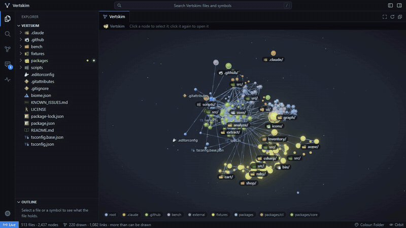
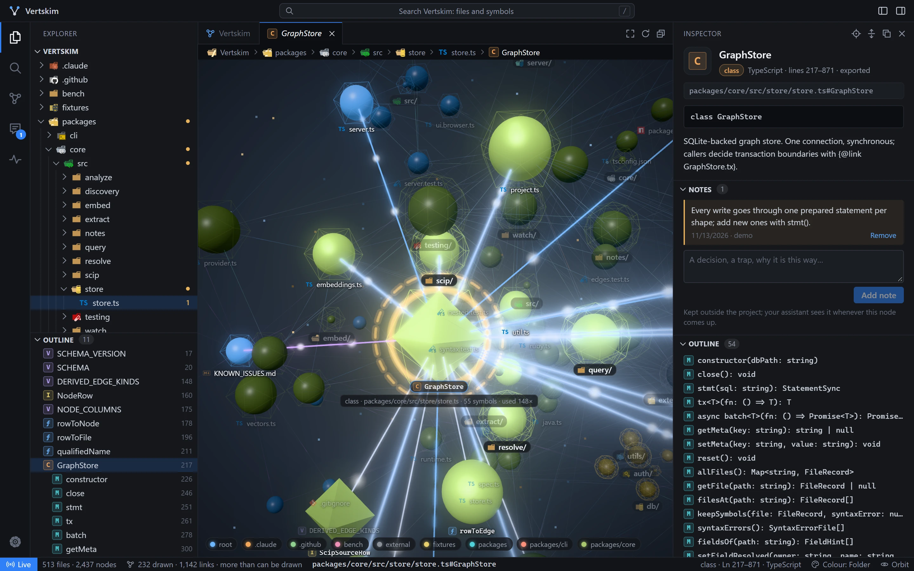
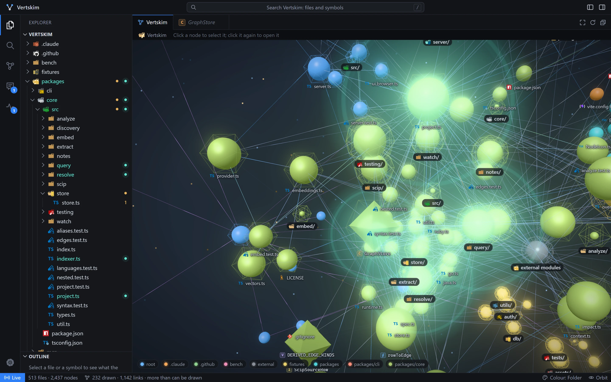
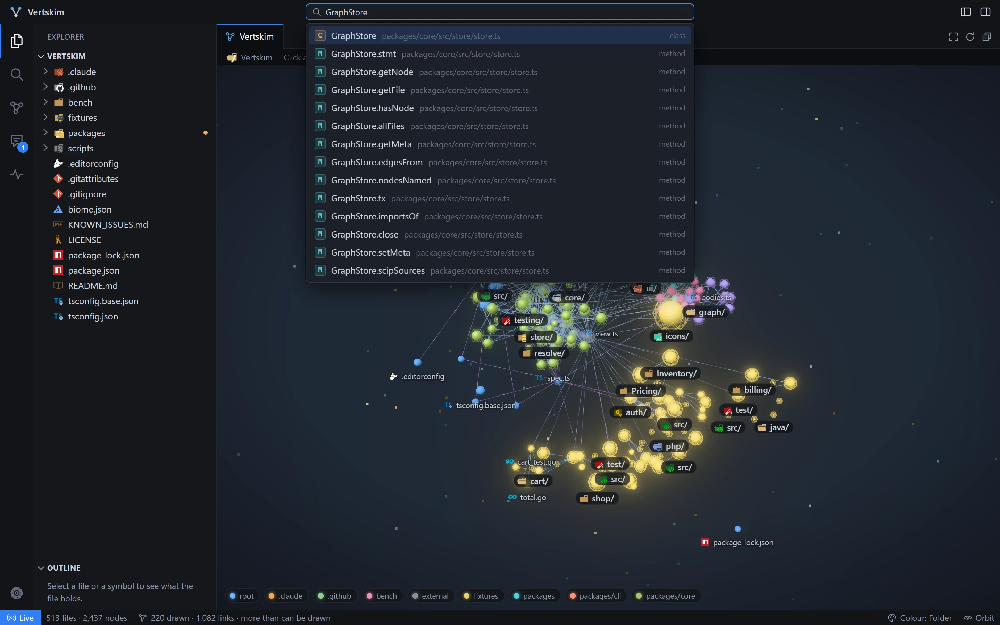
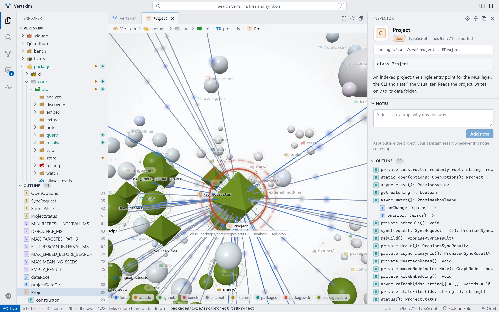
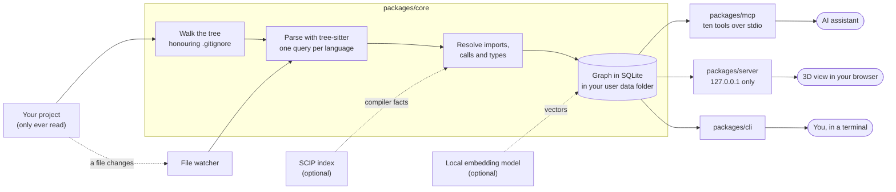
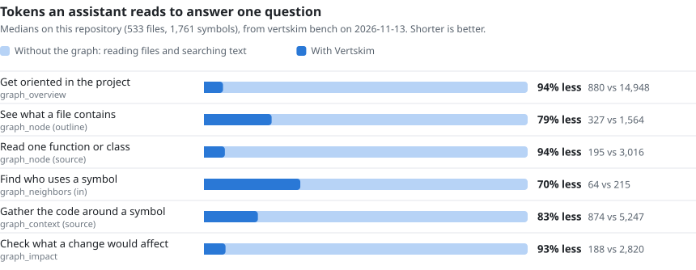
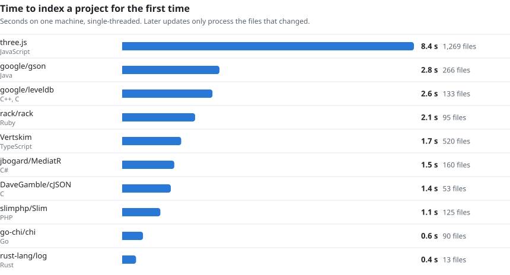
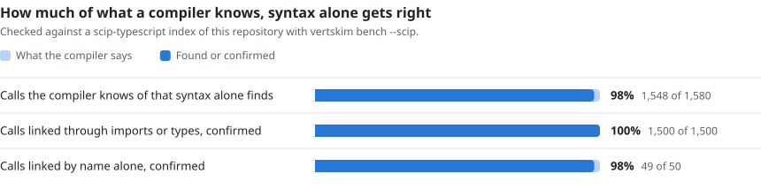

<div align="center">


# Vertskim

**A local knowledge graph of your codebase, served to AI assistants over MCP.**

Your assistant asks *"where is this defined?"*, *"who calls this?"* and *"what breaks if I change it?"*<br>
and gets a short, exact answer instead of reading whole files.

[](LICENSE)
[](#quick-start)
[](#the-ten-tools)
[](#languages)
[](#privacy-where-your-data-goes)
[](https://github.com/MyKa322/Vertskim/actions/workflows/ci.yml)
[](CONTRIBUTING.md)

[Quick start](#quick-start) ·
[The 3D view](#the-3d-view) ·
[Tools](#the-ten-tools) ·
[Benchmarks](#benchmarks) ·
[Languages](#languages) ·
[Contributing](CONTRIBUTING.md) ·
[Licence and credit](#licence-and-credit)



<sub>The 3D view on Vertskim's own source: orbit the project, search for a class and fly to it, watch the
nodes an assistant asks about light up. <a href="docs/media/demo.mp4">Watch it as a video (MP4, 19 s)</a>.</sub>

</div>

---

## Why

An assistant that works on your code spends most of its context window reading files to find the
few lines that matter. Vertskim reads the project once, keeps a graph of what is defined where and
what uses what, and answers the assistant's questions from that graph.

| | |
|---|---|
| **70% to 94% fewer tokens per question** | Measured on this repository with `vertskim bench`; see [Benchmarks](#benchmarks) for what is compared and where it does not help. |
| **Everything stays on your machine** | No account, no upload, no telemetry. The project is only ever read; the graph lives in your user data folder. |
| **11 programming languages and Markdown** | TypeScript, JavaScript, Python, Go, Rust, Java, C#, C, C++, Ruby and PHP, each with its own rules for imports, scope and types. |
| **Always current** | Watches the project and re-links only what a change can affect, about a tenth of a second after you save. |
| **Honest about what it knows** | A relationship matched by name alone is marked `~` as a guess. Add a compiler index and guesses become facts. |
| **A picture of the project** | A live 3D view in your browser that shows the graph, and what your assistant is looking at. |
| **Memory between sessions** | Notes the assistant leaves on a function or file come back whenever that code comes up again. |

> [!NOTE]
> **Status: 0.1.0, built and tested on Windows.** All planned features work and are covered by 138
> tests plus 6 browser tests. The CI for Linux and macOS is written but has not run yet, and the
> package is not on npm, so you run it from a checkout. [KNOWN_ISSUES.md](KNOWN_ISSUES.md) says
> exactly what has been tried and what has not.

## Quick start

**You need** [Node.js](https://nodejs.org) 22.16 or newer (earlier 22.x releases lack the full-text
search built into SQLite). Nothing else: the database is Node's own SQLite and the parsers are
WebAssembly, so there is nothing to compile.

**1. Get it and build it**

```bash
git clone https://github.com/MyKa322/Vertskim.git
cd Vertskim
npm install
npm run build
```

**2. Point it at a project**

```bash
node packages/cli/dist/bin.js --root /path/to/project overview
```

The first run indexes the project (a second or two for a few hundred files) and prints a map of
it. Add `ui` instead of `overview` to open the [3D view](#the-3d-view).

**3. Connect your assistant**

With Claude Code, from the project's directory:

```bash
claude mcp add vertskim -- node /absolute/path/to/Vertskim/packages/cli/dist/bin.js mcp
```

With any other MCP client (Claude Desktop, Cursor, VS Code, Windsurf, Zed and so on), add a stdio
server to its MCP configuration:

```json
{
  "mcpServers": {
    "vertskim": {
      "command": "node",
      "args": ["/absolute/path/to/Vertskim/packages/cli/dist/bin.js", "mcp", "--root", "/path/to/project"]
    }
  }
}
```

Leave `--root` out when the client starts servers in the project directory. The root is taken
from `--root`, then the `VERTSKIM_ROOT` environment variable, then the current directory.

That is all. The assistant now has [ten tools](#the-ten-tools), and the graph keeps itself current
while the server runs.

> [!TIP]
> To type `vertskim` instead of the long path, add an alias to your shell profile:
> `alias vertskim='node /absolute/path/to/Vertskim/packages/cli/dist/bin.js'`
> (PowerShell: `function vertskim { node C:\path\to\Vertskim\packages\cli\dist\bin.js @args }`).
> The rest of this page writes `vertskim` for short.

## The 3D view

```bash
vertskim ui
```

This opens your browser on a picture of the project, laid out like an editor: an explorer of the
project's files on the left, the graph in the middle with a tab for each node you open, and an
inspector on the right.

<table>
  <tr>
    <td width="50%" valign="top">
      <a href="docs/media/inspector-dark.webp"></a>
      <br><sub><b>Inspect anything.</b> Click a node, a file in the explorer or a search result for its
      signature, doc comment, outline, relationships, notes and source.</sub>
    </td>
    <td width="50%" valign="top">
      <a href="docs/media/trail-dark.webp"></a>
      <br><sub><b>See what your assistant sees.</b> The nodes its tools just asked about glow in the
      graph and are marked in the explorer.</sub>
    </td>
  </tr>
  <tr>
    <td width="50%" valign="top">
      <a href="docs/media/search-dark.webp"></a>
      <br><sub><b>Search and fly.</b> <code>/</code> or <code>Ctrl+P</code> finds files and symbols by name,
      and by meaning when <a href="#optional-search-by-meaning">that is switched on</a>.</sub>
    </td>
    <td width="50%" valign="top">
      <a href="docs/media/inspector-light.webp"></a>
      <br><sub><b>Light and dark.</b> Follows your system, or pick one with the gear at the bottom of
      the activity bar.</sub>
    </td>
  </tr>
</table>

- Directories start as single nodes and open as you fly into them, or when you click them twice.
- Hovering a node, or a row that names one, lights it up with what it is tied to.
- The page updates as files change, without a reload.
- An assistant gets the same link from the `graph_open_ui` tool, and can make the page fly to a node.

| Key | Does |
|---|---|
| `/` or `Ctrl+P` | Search files and symbols |
| `Ctrl+B` | Show or hide the side bar |
| `Ctrl+Shift+E` | Explorer |
| `Ctrl+Shift+F` | Search view |
| `Escape` | Let go of the selection |

The server listens on `127.0.0.1` only (port 4517, or a free one), and the link carries an access
key, so other programs and other users on the machine cannot read your project through it.
`--no-open` prints the link without opening a browser; `--port` picks the port.

## How it works



1. **Walk.** Every file gets a node. `.gitignore` and `.vertskimignore` are honoured; build and
   dependency folders are skipped.
2. **Parse.** Files in a [parsed language](#languages) go through [tree-sitter](https://tree-sitter.github.io/).
   One query per language picks out definitions, calls, imports, inheritance and typed variables.
3. **Resolve.** Imports are followed to files, calls to definitions, `value.method()` to the class
   the value's type names. What can only be matched by name is kept, marked as a guess.
4. **Store.** Nodes and edges go into a SQLite database outside the project, with full-text search
   over names, signatures and doc comments.
5. **Serve.** The same graph answers the MCP tools, the command line and the 3D view.

The graph holds files, directories, classes, interfaces, functions, methods, variables, types and
doc sections, connected by `imports`, `calls`, `references`, `extends`, `implements`, `tests`,
`mentions` and `links_to` edges.

## The ten tools

| Tool | Use it for | Returns |
|---|---|---|
| `graph_overview` | Getting oriented in a project or directory | Size, languages, layout, entry points, the most depended-on files and symbols, external dependencies |
| `graph_context` | Starting a task | The most relevant symbols for a task description or seed ids, with source for the core ones on request |
| `graph_search` | Finding a file, symbol or doc section by name, keywords or path fragment, and by description when search by meaning is on | Ranked matches with id, kind, signature and location |
| `graph_node` | Inspecting specific nodes | Signature, doc comment, an outline of members, direct relationships, and the node's own source lines on request |
| `graph_neighbors` | "Who uses this?" and "what does this depend on?" | Callers, callees, importers, subclasses, tests and docs, up to three hops |
| `graph_impact` | Checking a change before making it | Everything that depends on the targets, nearest first, plus tests to run and docs that mention them |
| `graph_path` | "How does A reach B?" | The shortest chain of relationships, in either direction |
| `graph_annotate` | Keeping what was learned | Saves a note on a node, lists notes, or removes one. Notes appear with their node in the tools above |
| `graph_sync` | Results that look out of date | Re-checks the project (or given paths) and reports what changed; can rebuild the index |
| `graph_open_ui` | Showing the project as a picture | The link to the 3D view, optionally flying to one node |

All tools are read-only except `graph_sync`, which changes the index, `graph_annotate`, which
writes notes to the data folder, and `graph_open_ui`, which starts the local server. None of them
changes the project. Query tools take `max_tokens` and end their reply with a line saying how
current the index is.

**What an answer looks like.** Asked what a change to one method would affect, on this repository:

```console
$ vertskim impact "packages/core/src/store/store.ts#GraphStore.addEdge"
impact of changing packages/core/src/store/store.ts#GraphStore.addEdge (method)
10 dependents in 5 files, up to 3 hops away
direct (4)
  packages/core/src/resolve/interfaces.ts#linkImplicitInterfaces  function · L67-172  calls
  packages/core/src/resolve/resolver.ts#Resolver.addEdge  method · L456-466  calls
  packages/core/src/store/store.ts#GraphStore.ensureDirectory  method · L538-562  calls
  packages/core/src/store/store.ts#GraphStore.replaceFile  method · L425-502  calls
2 hops (4)
  packages/core/src/indexer.ts#Indexer.sync  method · L72-245  calls packages/core/src/store/store.ts#GraphStore.replaceFile
  packages/core/src/resolve/resolver.ts#Resolver.resolve  method · L185-241  calls packages/core/src/resolve/interfaces.ts#linkImplicitInterfaces
  ...
index: fresh (528 files, 2469 nodes)
```

Edges prefixed with `~` were matched by name only and are worth confirming in the source. Search
results prefixed with `≈` were found by meaning rather than by name.

### Node ids

Ids are readable and stable, and are what you pass between tools:

| Node | Example |
|---|---|
| File | `src/auth/session.ts` |
| Directory | `src/auth/` (the project root is `./`) |
| Symbol | `src/auth/session.ts#SessionStore.refresh` |
| Doc section | `docs/guide.md#install` (the heading's GitHub anchor) |
| Third-party module | `ext:npm/react`, `ext:py/requests` |

### The same from a terminal

Every tool has a command, for trying things out and for scripts:

```bash
vertskim overview                                   # map the project
vertskim search "session refresh"                   # find files, symbols, doc sections
vertskim node src/auth/session.ts --source          # one node, with its source
vertskim neighbors "src/auth/tokens.ts#rotate" --in # who uses it
vertskim impact "src/auth/tokens.ts#rotate"         # what a change would affect
vertskim path src/cli.ts "src/auth/tokens.ts#rotate"  # how one reaches the other
vertskim context "refresh tokens are not rotated" --detail source
vertskim note src/auth/tokens.ts "Rotation must stay idempotent"
vertskim watch                                      # keep the graph current, report each update
vertskim status                                     # where the index lives, how big it is
```

`vertskim --help` lists every command and option. Add `--root <dir>` to work on a project other
than the current directory.

## Benchmarks

Everything here was measured on this repository or on public projects, on one Windows 11 machine,
and can be measured again on yours: the numbers behind the charts are in
[bench/results.json](bench/results.json) and `npm run charts -- --measure` redraws them.

### Tokens

`vertskim bench` compares, on your project, the size of what the tools return with the size of
what an assistant would otherwise read to answer the same question.

<picture>
  <source media="(prefers-color-scheme: dark)" srcset="docs/media/chart-tokens-dark.svg">
  
</picture>

<details>
<summary>The numbers, and how to read them</summary>

<br>

Median tokens per question on this repository (533 files, 1,761 symbols), 13 November 2026:

| Question | Without the graph | With it | Difference |
|---|---:|---:|---:|
| Get oriented in the project | 14,948 | 880 | 94% less |
| See what a file contains | 1,564 | 327 | 79% less |
| Read one function or class | 3,016 | 195 | 94% less |
| Find who uses a symbol | 215 | 64 | 70% less |
| Gather the code around a symbol | 5,247 | 874 | 83% less |
| Check what a change would affect | 2,820 | 188 | 93% less |

- "Without the graph" is a stated assumption per question, printed with the results: reading the
  whole file to see one function, a whole-word text search to find users, the same search with ten
  lines of context to judge a change. An assistant that already knows where to look reads less.
- The saving grows with the size of the project. On the 18-file sample under `fixtures/sample`
  the same run shows 50% less for reading a function, 10% less for gathering context, and 113%
  *more* for the overview: there is little to save in a project that fits on a screen.
- The graph's answer was the longer one in a few cases (8 of 40 outlines, 3 of 40 "who uses"
  questions here); the output says how many.
- Tokens are estimated at 3.6 characters each, the same way on both sides.
- Only size is measured, not whether the answer is right or complete. A text search finds uses
  the graph cannot see, such as names in strings; the graph tells a call from a comment.

</details>

### Speed

<picture>
  <source media="(prefers-color-scheme: dark)" srcset="docs/media/chart-indexing-dark.svg">
  
</picture>

<details>
<summary>The numbers</summary>

<br>

| Project | Language | Files | First index |
|---|---|---:|---:|
| three.js | JavaScript | 1,269 | 8.4 s |
| google/gson | Java | 266 | 2.8 s |
| google/leveldb | C++, C | 133 | 2.6 s |
| rack/rack | Ruby | 95 | 2.1 s |
| Vertskim | TypeScript | 520 | 1.7 s |
| jbogard/MediatR | C# | 160 | 1.5 s |
| DaveGamble/cJSON | C | 53 | 1.4 s |
| slimphp/Slim | PHP | 125 | 1.1 s |
| go-chi/chi | Go | 90 | 0.6 s |
| rust-lang/log | Rust | 13 | 0.4 s |

Vertskim and three.js are medians of three runs on 13 November 2026; the other eight were measured
once on 12 November ([KNOWN_ISSUES.md](KNOWN_ISSUES.md#eight-outside-projects-n5) has the details).

</details>

- **After the first index, only changed files are processed.** An edit shows up in the graph about
  a tenth of a second after the save.
- **Largest thing tried:** all of this repository's `node_modules`, 6,447 files and 65,505 nodes.
  First index in 29 s, a 176 MB database, 294 to 392 MB of memory, and every query answered in
  42 ms or less.

### Accuracy

Vertskim works relationships out from syntax, without a type checker. To see how much that costs,
`vertskim bench --scip` compares its graph with what a compiler says.

<picture>
  <source media="(prefers-color-scheme: dark)" srcset="docs/media/chart-accuracy-dark.svg">
  
</picture>

- On this repository, against a `scip-typescript` index: syntax alone finds **98%** of the calls
  the compiler knows of, every call linked through imports or types is confirmed, and of the 50
  name-only guesses 49 are confirmed (the compiler has no view on the 50th).
- On eight open-source projects in other languages, every sampled resolved call was right (24 of
  24) and name-only guesses were right in most samples but not all: between 6 of 8 and 9 of 10,
  depending on the language.
- Finding the right starting point from a plain-language question is the weakest part: over 34
  questions about this repository with known answers ([bench/questions.json](bench/questions.json)),
  the right answer is in search's first five for 20 from names alone, and for 22 with
  [search by meaning](#optional-search-by-meaning).

## Languages

| Language | Files | Tried on |
|---|---|---|
| TypeScript, TSX | `.ts` `.mts` `.cts` `.tsx` | this repository |
| JavaScript, JSX | `.js` `.mjs` `.cjs` `.jsx` | `three.js` |
| Python | `.py` `.pyi` | fixtures only |
| Go | `.go` | `go-chi/chi` |
| Rust | `.rs` | `rust-lang/log` |
| Java | `.java` | `google/gson` |
| C# | `.cs` | `jbogard/MediatR` |
| C | `.c` `.h` | `DaveGamble/cJSON` |
| C++ | `.cpp` `.cc` `.hpp` | `google/leveldb` |
| Ruby | `.rb` | `rack/rack` |
| PHP | `.php` | `slimphp/Slim` |
| Markdown | `.md` `.mdx` `.markdown` | this repository |

Every other file still gets a node, so links and mentions can point at it.

What "parsed" means, beyond finding definitions:

- **Imports are followed** by each language's own rules: namespace imports, re-exports and default
  exports; path aliases from `tsconfig.json` and `package.json`; Go packages and `go.mod`; Rust
  modules and `impl` blocks; Java packages; C# namespaces; C and C++ includes (a call reaches the
  definition in the source file, not the declaration in the header); Ruby's `require` and its
  global constants; PHP namespaces and `use`.
- **Types settle calls.** The types written on parameters, variables and fields, and what
  `new X()` or a function with a declared return type gives, say which class a `value.method()`
  call belongs to.
- **Go's implicit interfaces** get `implements` edges, as guesses.
- **Anything matched by name alone is labelled as a guess.**

Want another language? [Adding one is a single file](CONTRIBUTING.md#adding-a-programming-language).

## Notes that outlive the session

An assistant starts every session knowing nothing about the last one. `graph_annotate` lets it
leave what it worked out (a decision and its reason, a trap, unfinished work) on the file, symbol
or directory it is about:

```
graph_annotate { "id": "src/auth/tokens.ts#rotate", "note": "Must stay idempotent: retries call it twice." }
```

From then on the note is part of what `graph_node`, `graph_context`, `graph_search` and
`graph_overview` say about that node, and `graph_search` also matches the words of notes.

- Notes are stored in `notes.db` in the data folder, separately from the index, so re-indexing
  and upgrades keep them. Nothing is written into the project.
- Each note remembers what its code looked like. When that function, class or file changes
  afterwards, the note is still shown but marked as written before the change. Notes follow code
  that is renamed or moved; those whose node is gone are listed by `graph_annotate` with no
  arguments.
- You can read, add and remove notes yourself: `vertskim note`, `vertskim notes`, or the Notes
  box in the 3D view.

## Optional: compiler-accurate relationships

For `store.refresh()` syntax cannot know the type of `store`, so Vertskim either guesses from the
name (marked `~`) or draws nothing. A compiler knows. [SCIP](https://github.com/sourcegraph/scip)
is a file format in which compiler-backed indexers write down exactly which name refers to which
definition, and Vertskim can read it.

```bash
npx @sourcegraph/scip-typescript index      # writes index.scip
vertskim scip index.scip                    # use it
```

<details>
<summary>Which indexers exist, and exactly how an index is used</summary>

<br>

Indexers exist for TypeScript and JavaScript (`scip-typescript`), Python (`scip-python`), Java,
Scala and Kotlin (`scip-java`), Rust (`rust-analyzer`), C and C++ (`scip-clang`), Ruby
(`scip-ruby`), C# (`scip-dotnet`), Dart and PHP. Vertskim does not run them; you do. (`scip-python`
0.6.8 does not run on Windows; use Linux or WSL for it. For a JavaScript project add
`--infer-tsconfig`, and `--output <file>` to put the index somewhere else.)

- Say which index to use with `vertskim scip <file>`: one at the project root, in a package of a
  monorepo, or a file from your CI. An `index.scip` that is simply there, perhaps one that came
  with a clone, is reported but not used until you add it. `vertskim scip` lists the indexes and
  how many files each covers; `vertskim scip --forget <file>` stops using one.
- In the files an index covers, a guess the compiler confirms becomes a plain edge, and
  relationships syntax cannot see are added: calls through fields, interfaces and inferred
  types, uses of a type's fields, and which method implements or overrides which.
- A guess is removed only when the compiler contradicts it: it resolved that name, used that way
  in that function, to something else (a library method, say). Where the compiler has no opinion,
  as with a value typed `any`, the guess stays and stays marked `~`.
- In a monorepo, packages usually see each other through built declaration files, so a call into
  another package refers to `dist/store.d.ts`, not `src/store.ts`. Vertskim follows such a
  reference back to the source when exactly one file of that package fits.
- An index is a snapshot. Its facts about a relationship are used only while both files involved
  are byte-for-byte what they were when it was read. Edit a file and its edges fall back to
  syntax until you run the indexer again; the index file is re-read whenever it changes.
- Nothing is taken on trust: before a fact is used, the name has to be at the position in the
  file where the index says it is. A file that no longer matches its index is left out, and
  `vertskim scip` says how many were.
- The index file is the indexer's output, not Vertskim's. Vertskim never writes it and does not
  index it. Keep it out of version control, or outside the project, as you prefer.
- Only `scip-typescript` has been run for real. Indexes from the other indexers are read by the
  same code, but what each one emits differs in details that only show up on real output.

</details>

## Optional: search by meaning

Search matches names, signatures and doc comments. A question phrased in words the code never
uses ("renew expired credentials" for a method called `refresh`) finds nothing that way. With an
embedding model, `graph_search` and `graph_context` also find code by what it does.

Vertskim does not contain or download a model. It uses one that runs on your machine:

```bash
ollama pull nomic-embed-text      # once, if you use Ollama
vertskim embed                    # finds the model, makes the vectors
```

<details>
<summary>Other model servers, and what happens to your code</summary>

<br>

- **Ollama:** `vertskim embed` finds an embedding model by itself, or name one with
  `--model <name>`. `OLLAMA_HOST` is honoured.
- **LM Studio, llama.cpp and anything else that serves `/v1/embeddings`:**
  `vertskim embed --provider openai --url http://127.0.0.1:1234/v1 --model <name>`.
- **In-process:** `vertskim embed --provider transformers --model <name>` runs the model inside
  Vertskim with [transformers.js](https://huggingface.co/docs/transformers.js), if you have
  installed `@huggingface/transformers` next to it. That library fetches the model from Hugging
  Face the first time it is used. This provider has not been run yet.

What happens then:

- Every function, method, class, interface, type, doc section and parsed file gets one vector,
  made from its name, location, signature, doc comment and first lines. Vectors are stored in
  `vectors.db` in the data folder and survive the index being rebuilt.
- A vector is remade only when that text changes. The MCP server, `vertskim ui` and
  `vertskim watch` do this in the background after each update; `vertskim embed` does it now and
  shows progress.
- A one-word query that matches a name is answered from names alone, without asking the model.
  For anything else, matches by name and by meaning are merged; what both agree on comes first,
  and what only the model found is marked `≈`.
- If the model server is not running, search carries on by name alone and `graph_sync` says so.
- Only a model server on this machine is accepted. `--allow-remote` lifts that, in which case the
  text described above is sent to that server; `--key-env NAME` reads its key from an environment
  variable, and the key is never stored.
- `vertskim embed --off` switches it off and deletes the vectors.

What it did on this repository, with `nomic-embed-text` served by Ollama 0.40.13: 998 vectors in
about 40 seconds the first time, model loading included, and 12 seconds on a re-run. A question
usually costs 15 to 20 ms. The same model file served by llama.cpp's `llama-server` worked through
the `openai` provider. It widens what search can find; it does not replace knowing a name.

</details>

## How it stays current

- The server watches the project with the operating system's own change notifications and
  updates the graph about a tenth of a second after a burst of saves ends.
- Before answering, a tool checks the files of the nodes it was asked about directly on disk, so
  an edit made a moment earlier is seen even if the notification has not arrived.
- A full re-scan runs when the server starts, when ignore rules change, and every ten minutes of
  use as a check against missed notifications.
- Where no watcher is available, the project is re-scanned before queries instead, at most every
  1.5 seconds.
- Several clients can run a server on the same project. A lock file in the data folder lets one
  process at a time rewrite the graph; the others then find little or nothing left to do.

## Privacy: where your data goes

- **Nothing is sent over the network**, with one exception you have to switch on: search by
  meaning sends text to the embedding model server you chose, which has to be on this machine
  unless you explicitly allow another.
- **Nothing is written inside your project.** The database is stored in `%LOCALAPPDATA%\vertskim\`
  on Windows, `~/Library/Application Support/vertskim/` on macOS, and `~/.local/share/vertskim/`
  on Linux. Set `VERTSKIM_DATA_DIR` or pass `--data-dir` to move it. `vertskim status` prints the
  exact folder.
- The database holds names, signatures, doc comments and line numbers. Source text is read from
  disk when asked for and is not copied into it.
- Notes are kept beside it in `notes.db`. The index can be deleted and rebuilt at any time; the
  notes file is the only thing in the folder that cannot be recreated.
- With the optional extras in use, the folder also holds `scip.json` (index files you pointed
  at), `embeddings.json` (the model you chose) and `vectors.db`.
- The server tells the assistant that text quoted from your repository is data, not
  instructions, and control characters are stripped from everything the tools print.

### What gets indexed

`.gitignore` files are honoured at every level, along with an optional `.vertskimignore` in the
same format. Common build, cache and dependency folders (`node_modules/`, `vendor/`, `dist/`,
`build/`, `target/`, `.venv/`, `.next/`, `.svelte-kit/` and similar) and minified files and source
maps (`*.min.js`, `*.min.css`, `*.map`) are skipped by default; re-include one with a negated
pattern such as `!dist/` in `.vertskimignore`. Symlinks are not followed.

## Limits

<details>
<summary>What Vertskim cannot do, in detail</summary>

<br>

- Without a SCIP index, edges come from syntax, not from a type checker. A call on a value whose
  type is unknown (`store.refresh()`) is linked only when exactly one method has that name, and
  is marked `~`. When several candidates exist the edge is left out, so `graph_impact` can miss
  such callers.
- Types are known only where the code writes them down or makes them obvious: a declared type,
  `new X()`, a function with a declared return type, a value copied from another. Inferred types
  are not worked out, so `const x = make()` with `make` untyped, or a Ruby block parameter, leaves
  the type unknown and calls on it fall back to the name-only rule above.
- Language by language:
  - Rust: calls inside macro arguments are read from the macro's tokens, but nothing a macro
    generates (derives, custom syntax) is seen.
  - Go: an `implements` edge means the type has methods of the same names and the same number of
    parameters and results; parameter types are not compared, so these edges are guesses. An
    interface more than 50 types satisfy (`String() string`) gets none.
  - C and C++: include paths come from where files are, not from the build, so any project file
    whose path ends in the written one will do. Macros are not expanded. When a declaration has
    several definitions (overloads, `static` functions of the same name), uses stay at the
    declaration. C is parsed with the C++ grammar.
  - Ruby: methods made by metaprogramming (`attr_reader`, `define_method`) are not nodes, and only
    `x = Foo.new` gives a variable a type.
  - PHP: classes are found through `use` and namespaces; `require` and `include` are not
    followed, on the assumption that an autoloader loads classes.
- Kotlin, Swift and other languages without a bundled grammar get a node but are not parsed.
  The bundled grammars can lag behind their languages: a C# 12 collection expression
  (`return [];`) is a syntax error to them.
- Indexing is single-threaded, on the server's main thread: roughly 100 to 200 files per second
  on first run. Later updates only process changed files.
- Without search by meaning, `graph_context` finds starting points by matching words against
  names, signatures and doc comments, so a task phrased in words the code never uses needs
  `seeds`.
- A SCIP index only adds relationships between things Vertskim has nodes for. In languages it
  does not parse, and for local variables, parameters and fields, an index adds nothing (a use of
  a field counts as a use of its type). An index has to be re-made by you after edits; nothing
  runs indexers automatically.
- Search by meaning is as good as the model you give it, and always returns its closest matches
  even when nothing in the project is really about the question. Vectors are searched in memory:
  at most 80,000 nodes are embedded, about 3 MB of memory per thousand at 768 dimensions.
- The server builds each picture of the 3D view from a copy of the whole graph held in memory,
  which has not been tried on very large repositories.
- Run on Windows only so far, and not published to npm yet.

</details>

[KNOWN_ISSUES.md](KNOWN_ISSUES.md) lists every known issue with its severity and status.

## Development

```
packages/core    indexing engine, graph store, watcher and analysis (no MCP, no HTTP)
packages/mcp     MCP tools, output formatting, token budgets, the benchmark
packages/server  local HTTP server behind the 3D view: API, live events, access checks
packages/ui      the 3D view itself (React + 3d-force-graph), built into static files
packages/cli     the `vertskim` command
fixtures/        sample projects used by the tests, one or more per language
bench/           the question set and the measurements behind the charts above
docs/media/      the screenshots, demo and charts on this page
scripts/         build helpers, and the scripts that make docs/media
```

| Command | Does |
|---|---|
| `npm run build` | Type-checks and builds every package, and the 3D view |
| `npm test` | Builds, then runs the 138 tests (needs no browser) |
| `npm run test:browser` | Drives the 3D view in Chromium; run `npx playwright install chromium` once first |
| `npm run lint` | Checks code and formatting with [Biome](https://biomejs.dev) |
| `npm run format` | Formats the code |
| `npm run charts` | Redraws the charts in `docs/media` from `bench/results.json` |
| `npm run media` | Retakes the screenshots and the demo from the real 3D view (needs Chromium; `ffmpeg` for the GIF) |

[CONTRIBUTING.md](CONTRIBUTING.md) explains how to add a language, a theme, a fix or a speed-up,
and how to report an issue.

## Roadmap

- [x] Indexer, SQLite store, and the search, node and neighbours tools over stdio
- [x] File watcher and targeted updates; overview, context, impact, path and sync
- [x] Local HTTP server with live events, the 3D view, `graph_open_ui`
- [x] Notes written back by the assistant; the token benchmark
- [x] Compiler-accurate edges from SCIP indexes; optional search by meaning
- [x] C, C++, Ruby and PHP; typed receivers; accuracy measurements; trials on eight open-source
      projects and with Claude Code as a real MCP client; browser tests
- [ ] Run the CI on Linux and macOS
- [ ] Publish to npm, so that `npx vertskim` works
- [ ] Try the other SCIP indexers and the `transformers` embedding provider
- [ ] Kotlin, Swift and more languages (needs grammars from outside the bundled set)
- [ ] Parse off the main thread, so that tools answer at full speed during a first index

## Licence and credit

Vertskim is open source under the [Apache License 2.0](LICENSE). You may use it, change it and
build on it, privately or commercially, for free.

**What is asked in return is credit, and the licence makes it a condition.** If you distribute
Vertskim, publish a fork of it, or ship something built on it, you must:

1. **Keep the [NOTICE](NOTICE) file** with what you distribute. It names this project and links
   to this repository, <https://github.com/MyKa322/Vertskim>. If your product has no NOTICE file,
   put its text where your documentation or your product shows its third-party notices.
2. **Keep the copyright and licence notices**, and give recipients a copy of the licence.
3. **Say which files you changed.**

Using Vertskim yourself, without passing it on, asks nothing of you. A visible line of credit is
appreciated wherever you mention what your work is built on:

```markdown
Built on [Vertskim](https://github.com/MyKa322/Vertskim), licensed under Apache 2.0.
```

Copyright 2026 Vertskim and its contributors.

### Built with

- [tree-sitter](https://tree-sitter.github.io/) grammars, through
  [`@vscode/tree-sitter-wasm`](https://github.com/microsoft/vscode-tree-sitter-wasm), for parsing
- The [Model Context Protocol SDK](https://github.com/modelcontextprotocol/typescript-sdk) for the
  tools
- [three.js](https://threejs.org) and [3d-force-graph](https://github.com/vasturiano/3d-force-graph)
  for the 3D view, and [React](https://react.dev) for the page around it
- [SCIP](https://github.com/sourcegraph/scip) for compiler indexes
- File and folder icons from [vscode-icons](https://github.com/vscode-icons/vscode-icons), licensed
  by its contributors under [CC BY-SA 4.0](https://creativecommons.org/licenses/by-sa/4.0/); icons
  of brands remain under their owners' terms. See
  [packages/ui/src/icons/README.md](packages/ui/src/icons/README.md).
